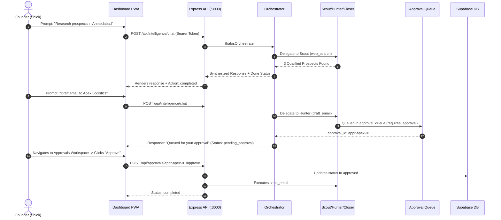

# 07. End-to-End Workflow & Deliverables Audit

## 1. Full Business Lifecycle Trace

---

## 2. File Generation Deliverables
- **PDF Generation:** Implemented via PDFKit:
  - Proposals: `src/business/proposalPdf.ts` (`buildProposalPDF`) generates downloadable PDF with Yugantar branding, scope, line items, and terms.
  - Invoices: `src/business/invoicePdf.ts` (`buildInvoicePDF`) generates formatted tax invoices with GST calculations and bank payment details.
- **CSV Data Export:** Implemented in `src/execution/tools/reportingTools.ts` (`export_business_data`) supporting CSV export of leads and client pipelines.
- **Verification Result:** PDF generation verified in `tests/unit/businessOrgans.test.ts` (S05-AC-06).
